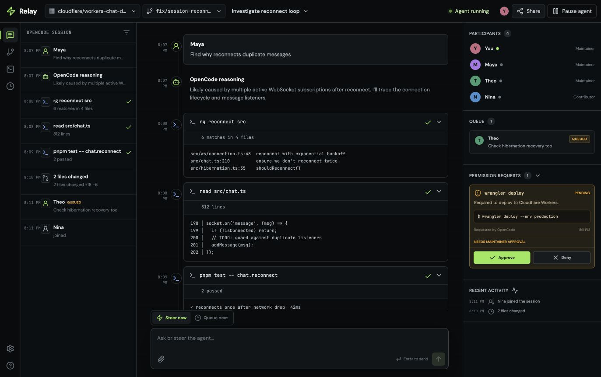
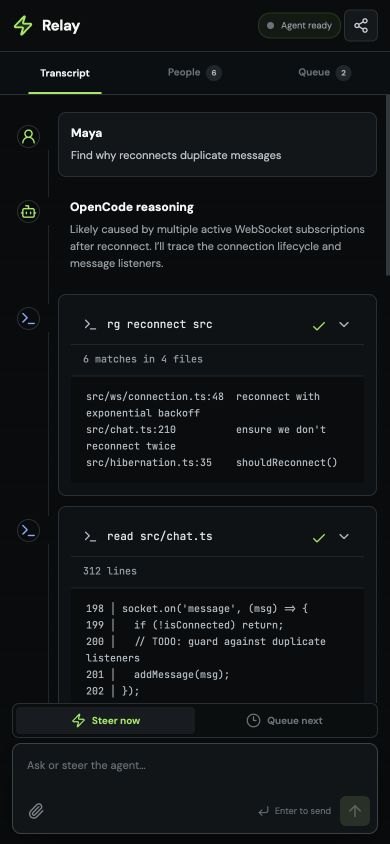

# Relay

[](https://github.com/aranlucas/multiplayer-chat/actions/workflows/ci.yml)
[](LICENSE)

## Bring the whole room into the coding loop.

Relay is a multiplayer coding-agent room. Share one link, watch an ordered OpenCode event stream, steer the agent or queue the next turn, review permissions and diffs together, and publish an exact-commit preview or pull request from the same repository workspace.





Local product captures of the desktop and mobile room.

## How it works

- A Cloudflare Durable Object owns each room’s state, SQLite-backed event history and OpenCode Workerd host. Prompts can be sent immediately (**Steer**) or held for the next turn (**Queue**).
- A Railway Sandbox provides the persistent, isolated repository workspace used by shell/file tools. GitHub OAuth enables pull-request publication.
- Preview handoff verifies the published commit and room protocol before activation, while participants continue using the existing room service.

## Run locally

Requirements: Node.js 24 and pnpm. The pinned `cf` CLI and Cloudflare Vite plugin are installed with the development dependencies.

```bash
corepack enable
pnpm install --frozen-lockfile
cp .dev.vars.example .dev.vars
pnpm dev
```

The Vite + Cloudflare plugin starts the local Worker and UI. The example variables select deterministic `simulation` mode, so a local room does not need OpenRouter or Railway credentials. Open **https://relay-multiplayer-agent.localhost** (`pnpm dev` runs through [Portless](https://github.com/vercel-labs/portless) (a dev dependency); its first run may ask for `sudo` to bind port 443 and trust a local certificate) and use the reconnect demo at `/r/reconnect-loop` to exercise a room.

To use the live OpenCode path, set `OPENCODE_MODE=live` and provide the matching provider key (`OPENROUTER_API_KEY`, `OPENCODE_ZEN_API_KEY`, or `CLOUDFLARE_API_TOKEN`), a Railway token/API token, and `RAILWAY_ENVIRONMENT_ID`. `OPENCODE_MODEL` and `OPENCODE_MODEL_ALLOWLIST` select the permitted model IDs. GitHub OAuth is only needed for pull-request publication.

OpenRouter can optionally run through [Cloudflare AI Gateway](https://developers.cloudflare.com/ai-gateway/usage/providers/openrouter/). Set `CLOUDFLARE_AI_GATEWAY_ID` to an existing gateway slug and `CLOUDFLARE_ACCOUNT_ID` to its account ID; keep `OPENROUTER_API_KEY` and the `openrouter/` model IDs. For an authenticated gateway, also provide `CLOUDFLARE_AI_GATEWAY_TOKEN` as a secret with gateway Run permission. The example variables document these options. Invalid gateway configuration is reported by `/api/health` and rejected at runner initialization.

Gateway requests log usage metadata, skip response caching, and require provider credentials rather than falling back to Unified Billing. Prompt and response bodies are excluded from gateway logs by default. Set `CLOUDFLARE_AI_GATEWAY_LOG_PAYLOADS=true` to opt into payload logging. This integration tags traffic as `application=relay`; it does not attribute inference to individual participants. Content classification and task analysis may require payload logging and further gateway settings.

## Verify

```bash
pnpm lint
pnpm format:check
pnpm typecheck
pnpm test
pnpm build
```

CI runs these gates plus `pnpm build:preview`. [vitest.config.ts](vitest.config.ts) separates Node/UI tests from Workerd room and SDK integration tests, with remote bindings disabled. These checks do not establish live-service availability.

For manual browser checks, `pnpm dev:e2e` starts a simulation server on port 5176; there is no `test:e2e` script. `pnpm cf-typegen` generates Worker types.

## Deploy

```bash
pnpm deploy
```

This builds the Worker and runs `cf deploy --prebuilt` with the generated `.cloudflare/output` build output. Cloudflare credentials and live-mode secrets must be configured in the target environment. Branch publication uses native [Worker Previews](https://developers.cloudflare.com/workers/previews/) under the same `relay-multiplayer-agent` Worker:

```bash
pnpm deploy:preview
```

Production and previews share `vite.config.ts`. `pnpm build:preview` sets `CLOUDFLARE_PREVIEW_BUILD=true` and mode `relay-preview`; both are required. The generated `.cloudflare/output/v0/config.json` must record `buildContext.isPreview: true` and mode `relay-preview`. Selecting the Vite mode alone does not mark the output as a native Preview build.

The publisher runs `cf previews deploy <branch> --prebuilt --mode relay-preview`. Provide `WORKERS_CI_BRANCH` and `WORKERS_CI_COMMIT_SHA` (or `GITHUB_HEAD_REF` and `GITHUB_SHA`). The build embeds `WORKERS_CI_COMMIT_SHA` (or `RELAY_BUILD_SHA`), so a publisher using only `GITHUB_SHA` must also set `RELAY_BUILD_SHA` to that same SHA during the build. The production branch is skipped. Other branches get a native Preview; branches named `relay/<room>--<suffix>` with an alphanumeric suffix also report their deployment to that room.

Room callbacks require `RELAY_CONTROL_ORIGIN` and the secret `RELAY_DEPLOYMENT_WEBHOOK_SECRET`, matching the production Worker's callback secret. The publisher reads Cloudflare's structured deployment result, verifies the immutable deployment URL against the exact commit and room protocol, then reports that URL and the deployment ID. It does not use the mutable branch URL for room revisions.

Previews serve the UI and readiness endpoint, and participants continue connecting to the existing production room service. They do not bind an isolated `AGENT_ROOMS` namespace, so a handoff retains the room's participants, transcript, and unsent draft. Preview URLs are public unless Cloudflare Access is configured.

Configure Workers Builds on `relay-multiplayer-agent` as follows:

| Target              | Build command            | Deploy command                     |
| ------------------- | ------------------------ | ---------------------------------- |
| Production (`main`) | `pnpm run build`         | `pnpm exec cf deploy --prebuilt`   |
| Previews (enabled)  | `pnpm run build:preview` | `node scripts/publish-preview.mjs` |

Set the room callback variables in the Previews build settings.

## Product and architecture decisions

- [Product purpose and constraints](PRODUCT.md)
- [Design principles and interaction requirements](DESIGN.md)
- [Proposed feature roadmap](ROADMAP.md)
- [Cloudflare integration decisions and migration candidates](docs/cloudflare-announcement-review.md)
